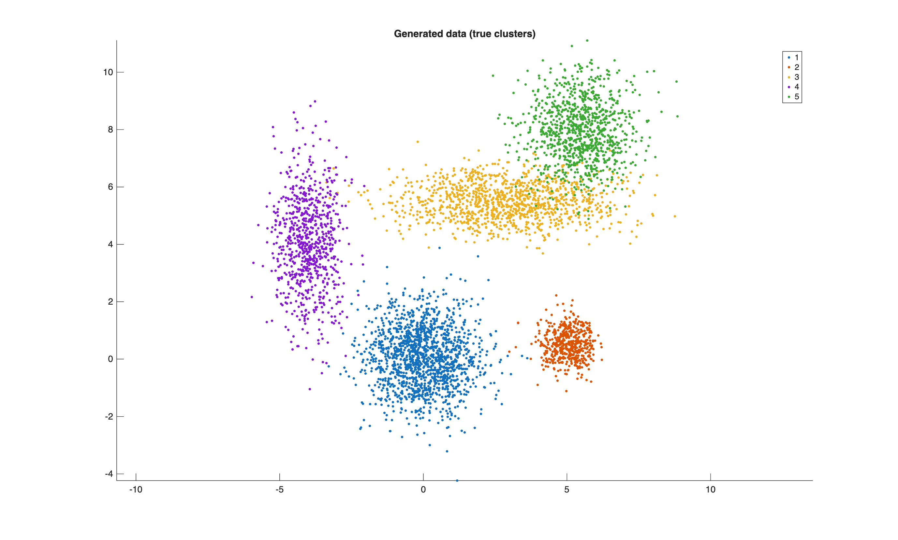
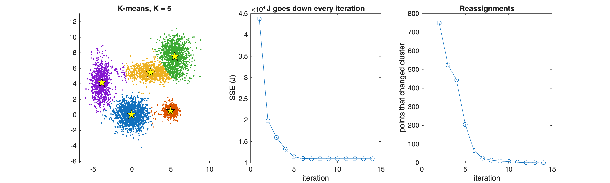
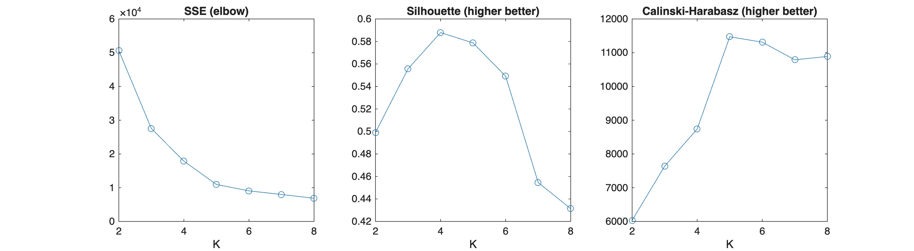
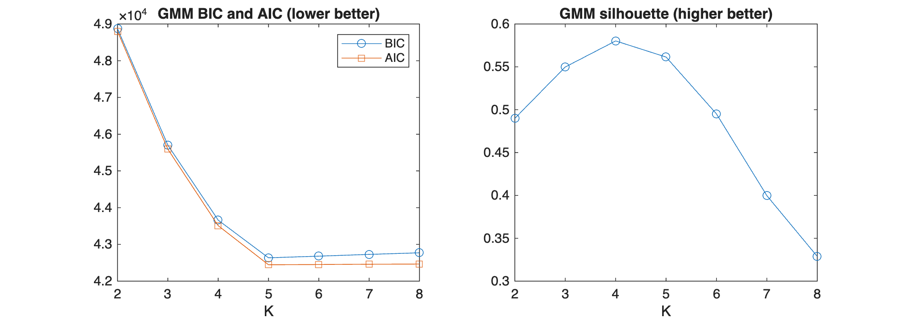
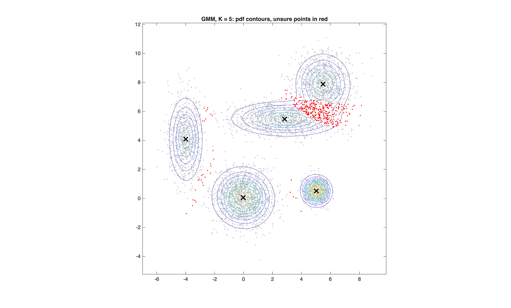
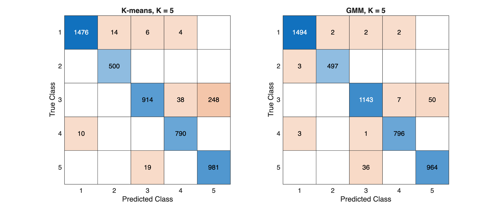
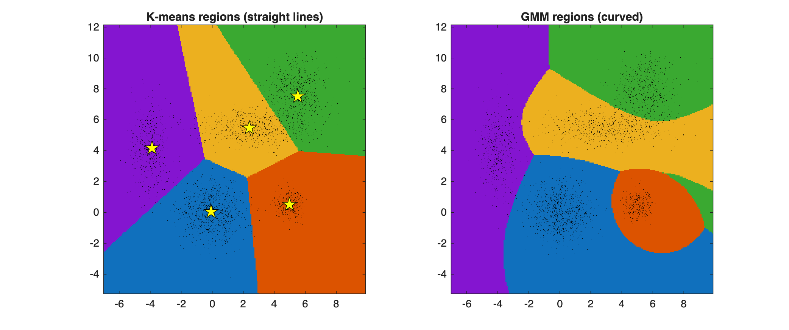

# Bayes-and-Clustering

Bayes classifiers on a small Boolean dataset, plus K-means (from first principles) and a Gaussian mixture model compared on synthetic 2D clusters. MATLAB.

## File map

| File | What it is |
|------|------------|
| [task1_bayes.m](task1_bayes.m) | task 1, naive Bayes and joint Bayes for P(U=1 \| x,y,z) on all 8 inputs |
| [main_task2.m](main_task2.m) | task 2, runs everything and saves the figures and the log |
| [generateData.m](generateData.m) | makes the dataset, 5 Gaussian clusters, 5000 points |
| [mykm.m](mykm.m) | k-means from first principle, k-means++ or random start, restarts |
| [fitGMM.m](fitGMM.m) | GMM with fitgmdist, EM started from my k-means result |
| [matchLabels.m](matchLabels.m) | names each cluster after the true class most of its points belong to |
| [clusterMetrics.m](clusterMetrics.m) | purity, entropy, V-measure, VI, accuracy, recall, precision |
| [results_log.txt](results_log.txt) | everything task 2 prints |
| [Docs/COMP3000_Exersices.pdf](Docs/COMP3000_Exersices.pdf) | the coursework brief |
| [fig1](figures/fig1_data.png) · [fig2](figures/fig2_kmeans_k5.png) · [fig3](figures/fig3_kmeans_chooseK.png) · [fig4](figures/fig4_gmm_k5.png) · [fig5](figures/fig5_gmm_chooseK.png) · [fig6](figures/fig6_confusion.png) · [fig7](figures/fig7_boundaries.png) | data, k-means, choosing K, GMM, choosing K for GMM, confusion matrices, decision regions |

## What I did

**Task 1**

- 7 rows, inputs x, y, z are 0 or 1, output is U
- naive Bayes, learns P(U) and P(input=1|U), multiplies them and divides by the total (Bayes rule) to get P(U=1|x,y,z)
- joint (full) Bayes, no assumption, just counts how many of the matching rows are U=1
- ran both on all 8 input combinations

**Task 2**

- made 5 clusters with different sizes and shapes so k-means has a hard time
- wrote k-means from first principle, assign each point to the closest centre, move each centre to the mean, stop when no point changes cluster
- k-means can get stuck depending on the starting points, so I run it 10 times and keep the run with the smallest SSE
- GMM with fitgmdist, full covariance so each Gaussian can stretch in its own way
- started EM from my k-means result instead of a random start, chose this to have the same fit on every run
- tried K = 2 to 8 for both
- compared both at K = 5 with the true classes, and with the best possible accuracy (true Gaussians + Bayes rule)
- plotted the decision regions to see why they are different

## How to run

needs MATLAB with the Statistics and Machine Learning Toolbox (fitgmdist, evalclusters, confusionchart, mvnpdf, pdist2)

```matlab
task1_bayes    %prints the task 1 table
main_task2     %makes figures/ and results_log.txt
```

my student number is used as the random seed so every run gives the same numbers as below

## Task 1: Bayes classifiers

P(U=0) = 3/7, P(U=1) = 4/7

| x y z | naive Bayes P(U=1) | joint P(U=1) |
|-------|-------------------:|-------------:|
| 0 0 0 | 0.6279 | 0 of 0, undefined |
| 0 0 1 | 0.2195 | 1 of 2 = 0.5 |
| 0 1 0 | 0.7714 | 1 of 1 = 1.0 |
| 0 1 1 | 0.3600 | 0 of 1 = 0.0 |
| 1 0 0 | 0.7714 | 1 of 2 = 0.5 |
| 1 0 1 | 0.3600 | 0 of 0, undefined |
| 1 1 0 | 0.8710 | 1 of 1 = 1.0 |
| 1 1 1 | 0.5294 | 0 of 0, undefined |

- joint has no answer for 3 of the 8 inputs, they are never seen in the table (0/0)
- naive Bayes gives an answer for all 8, but only because it assumes x, y, z are independent given U

## Task 2: K-means vs GMM

### The data

C1 is big, C2 is small and tight, C3 is long in x, C4 is long in y and C5 overlaps a bit with C3

| | mean | sd | points |
|---|---|---|---:|
| C1 | (0, 0) | (1.0, 1.0) | 1500 |
| C2 | (5, 0.5) | (0.5, 0.5) | 500 |
| C3 | (3, 5.5) | (2.0, 0.6) | 1200 |
| C4 | (-4, 4) | (0.6, 1.6) | 800 |
| C5 | (5.5, 8) | (1.0, 1.0) | 1000 |



### K-means, K = 5

- best SSE = 11406.58 after 15 iterations
- J goes down every iteration
- points that changed cluster per iteration: 5000, 398, 267 ... 0

does the starting point matter? 20 single runs with each way of starting

- k-means++ reached the best SSE 19/20, random start 14/20
- the bad runs got stuck at SSE = 18990.33, that is why I use restarts



### Choosing K

| K | k-means silhouette | k-means CH | GMM BIC | GMM AIC |
|---|---:|---:|---:|---:|
| 3 | 0.5555 | 7723.8 | 45883.1 | 45772.3 |
| 4 | **0.5876** | 8773.8 | 43752.1 | 43602.2 |
| 5 | 0.5708 | **11140.2** | **42700.7** | **42511.7** |
| 6 | 0.5474 | 10985.0 | 42740.1 | 42512.0 |

- CH, BIC and AIC all pick K = 5
- silhouette picks K = 4

why do some pick K = 4? with K = 4 k-means puts most of C3 and all of C5 into one cluster (1082 + 1000 points), see the crosstab in [results_log.txt](results_log.txt). silhouette likes round clusters far apart and C3 is not round




### GMM, K = 5

- log-likelihood = -21226.836
- the learned Gaussians are very close to the real ones, e.g. C3 sd (2.08, 0.62), true (2.0, 0.6)
- unsure points (no Gaussian above 0.9): 311 (6.2%), mostly where C3 and C5 overlap (152 and 129), in red



### Comparison

| K = 5 | K-means | GMM |
|---|---:|---:|
| accuracy | 0.9324 | **0.9782** |
| wrong points | 338 | **109** |
| V-measure | 0.8621 | **0.9382** |
| VI (lower is better) | 0.4276 | **0.1915** |
| entropy (lower is better) | 0.1322 | **0.0600** |
| silhouette | **0.5708** | 0.5460 |
| parameters | 10 | 29 |

- best possible accuracy with the true Gaussians = 0.9780, GMM gets 0.9782 so it is already at the limit
- the points left are in the overlap, no method can get them right
- k-means mostly loses on C3 (recall 0.766), it cuts C3 with straight lines and gives 238 of its points to C5
- GMM boundaries are curved and follow the shape of each Gaussian, C3 recall goes up to 0.978
- k-means still has the higher silhouette, silhouette rewards round clusters and that is what k-means makes



